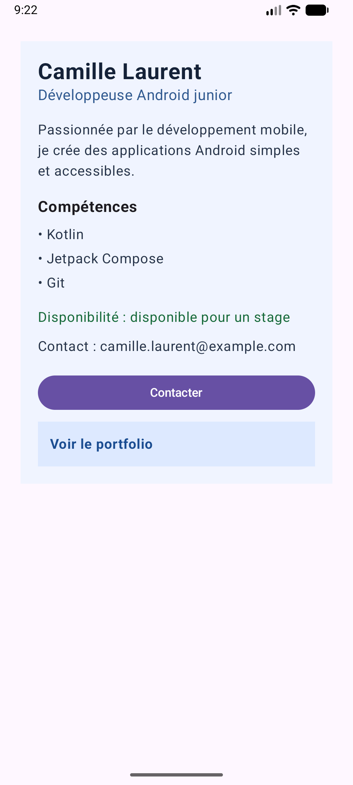

# Profil développeur Compose

## Description

Cette application Android affiche la fiche « Profil développeur » réalisée avec Jetpack Compose.
La fiche présente un nom, un rôle, une courte description, trois compétences, une disponibilité et un contact.
Un bouton « Contacter » et une zone cliquable « Voir le portfolio » transmettent leurs clics à l'écran parent via des callbacks.
Deux previews comparent un profil Android junior disponible et un profil full-stack non disponible.

## Notions utilisées

- Composables (`@Composable`) et découpage en petits composants.
- Paramètres pour transmettre les données aux composants enfants.
- Modifiers (`padding`, `fillMaxWidth`, `fillMaxSize`, `clickable`, `semantics`) et chaînage.
- Padding externe (autour de la fiche) / padding interne (dans la fiche).
- Callbacks (`onContactClick`, `onPortfolioClick`, `onClick`) pour remonter les événements au parent.
- Composants Material 3 : `Scaffold`, `Surface`, `Column`, `Text`, `Button`.
- Previews `@Preview` avec des données différentes.
- Accessibilité de base : `Role.Button` et `contentDescription`.

## Explication

**1. Quels composables avez-vous créés ?**
`ProfileScreen`, `ProfileCard`, `ProfileHeader`, `ProfileDescription`, `ProfileSkill`,
`ProfileAvailability`, `ProfileContact`, `ContactButton` et `PortfolioLink`,
plus les deux previews `ProfilePreviewAndroid` et `ProfilePreviewFullStack`.

**2. Quel composable représente l'écran principal ?**
`ProfileScreen` : appelé dans `MainActivity`, il fournit les données du profil et les callbacks à `ProfileCard`.

**3. Où utilisez-vous un padding externe ?**
Dans `ProfileScreen`, la fiche reçoit `modifier.fillMaxWidth().padding(24.dp)` :
le parent décide de la marge autour de `ProfileCard`.

**4. Où utilisez-vous un padding interne ?**
Dans `ProfileCard`, `Column(modifier = Modifier.padding(20.dp))` éloigne le contenu des bords de la fiche
(ainsi que `Modifier.padding(14.dp)` sur le texte de `PortfolioLink`).

**5. Quel composant reçoit un callback ?**
`ContactButton` et `PortfolioLink` reçoivent un `onClick`.
`ProfileCard` reçoit `onContactClick` et `onPortfolioClick` et les transmet à ces enfants.

**6. Quelle information d'accessibilité avez-vous ajoutée ?**
`PortfolioLink` déclare `Role.Button` (via `clickable`) et une `contentDescription`
« Afficher le portfolio de [nom] », lue par TalkBack.

**7. Pourquoi vos composants peuvent-ils être considérés comme réutilisables ?**
Ils ne contiennent pas de données fixes : textes, booléen, callbacks et `Modifier` sont passés en paramètres
(avec `Modifier` par défaut). Les deux previews réutilisent la même `ProfileCard` avec des profils différents.

## Capture

Capture réalisée sur l'émulateur Android (Medium Phone, API 37) avec le profil Android junior disponible.
